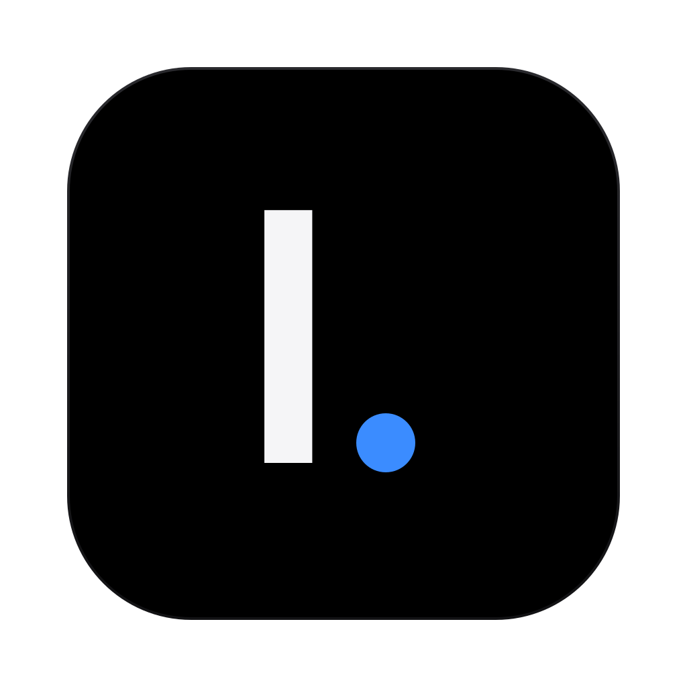

<p align="center">
  
</p>

<h1 align="center">Liame</h1>

<p align="center">
  A quiet, OLED-dark mail client for macOS.
</p>

<p align="center">
  <a href="https://github.com/pcstyle-os/liame/releases"></a>
  <a href="https://github.com/pcstyle-os/liame/actions/workflows/build.yml"></a>
  <a href="LICENSE"></a>
</p>

Liame is a desktop mail client that stays out of the way: one dark window, your
mail, and keyboard-first controls. It connects directly to your mail server over
IMAP/SMTP — there is no Liame server, no account to create, and no sync service
in between. Mail is cached locally so lists, conversations, and search are
instant and work offline; the server remains the source of truth.

## Features

- **Multiple accounts, one inbox** — Gmail, Zoho (all data centers), and any
  IMAP/SMTP server, plus an All Inboxes view that merges every account
- **Instant and offline** — headers, flags, and recent message bodies are kept
  in a local SQLite cache, so folders open immediately and search across
  folders is instant; a server search is there when you need the full text
- **Conversations** — messages are grouped into threads, including your own
  replies from Sent
- **Snooze, send later, follow-ups** — snoozed mail returns when you ask,
  scheduled sends go out on time, and reminders surface threads nobody
  answered
- **Keyboard first** — a command palette (`⌘K`), rebindable shortcuts for
  everything, bulk actions, and undo for moves
- **Optional AI, off the mail path** — draft and reply help, rewrites, an
  assistant that can summarize a thread or brief your unread mail, and
  automatic labels. Bring your own provider: a signed-in
  [Codex CLI](https://github.com/openai/codex), an OpenAI API key, or
  [TypeSafe](https://typesafe.ai) for labels. Nothing is sent to an AI
  provider until you ask or enable labels with a key. See
  [Privacy](#privacy-and-security)
- **Make it yours** — accent color, density, zoom, signature, snippets,
  mark-as-read behavior, and remote-image controls

## Install

Download `Liame-<version>-arm64.zip` from the
[latest release](https://github.com/pcstyle-os/liame/releases/latest), unzip
it, and move `Liame.app` to Applications. Builds are for Apple silicon
(`arm64`) and macOS with a current Electron runtime.

Releases are signed ad hoc (or with the maintainer's self-signed identity when
available), not with an Apple Developer ID, and are not notarized. On first
launch macOS may say the app is from an unidentified developer: right-click
the app, choose **Open**, and confirm. If macOS still refuses, run:

```sh
xattr -dr com.apple.quarantine /Applications/Liame.app
```

## Getting started

1. Open Liame and pick your provider: Gmail, Zoho, or Other IMAP.
2. Gmail and Zoho need an **app password**, not your account password — the
   setup screen links to where each provider creates one, and IMAP access
   must be enabled in your mail settings. For Other IMAP, enter your server
   hosts and ports (993/465 by default; 143 and 587/25 switch to STARTTLS).
3. Liame tests the connection before saving. Your password is encrypted with
   your macOS Keychain and never leaves this Mac except to your mail server.

## Privacy and security

- Liame talks only to the mail servers you configure and, when you use them,
  the AI providers you configure. There is no telemetry and no Liame backend.
- Account passwords and API keys are stored encrypted with Electron
  `safeStorage`, backed by your macOS Keychain, in files readable only by
  you. Passwords and keys never reach the renderer process; settings expose
  only whether a key is set.
- The renderer runs sandboxed with context isolation. Links in mail open in
  your default browser, and only `http(s):` and `mailto:` URLs are handed to
  the system.
- AI features are opt-in per use: the assistant sends the message or thread
  you are looking at (truncated) to the provider you chose. Automatic labels
  classify from sender, subject, and preview only, and only once you pick an
  engine and add its key.

Found a vulnerability? Please report it privately — see [SECURITY.md](SECURITY.md).

## Build from source

You need [Bun](https://bun.sh) 1.4.0 (the version CI pins) and, to run or
package the app, macOS on Apple silicon. Typecheck, tests, and the bundle
also run on Linux.

```sh
bun install --frozen-lockfile
bun run typecheck   # tsc --noEmit
bun test ./tests    # test suite
bun run build       # bundle main, preload, and renderer into out/
bun run dev         # run in development (macOS)
bun run dist        # package dist/mac-arm64/Liame.app (macOS)
```

Contributions are welcome — see [CONTRIBUTING.md](CONTRIBUTING.md) for the
development workflow and what CI checks.

## How it is built

- **Main process** (`src/main`) — IMAP via [imapflow](https://github.com/postalsys/imapflow),
  SMTP via [nodemailer](https://nodemailer.com), MIME parsing via
  [mailparser](https://github.com/nodemailer/mailparser), a local message
  cache on `node:sqlite`, Keychain-backed account and settings storage,
  scheduling for snoozes/sends/reminders, and the optional AI providers
- **Preload** (`src/preload`) — the single typed `window.liame` bridge; the
  renderer has no direct Node or IPC access
- **Renderer** (`src/renderer`) — React 19 UI; `src/shared/types.ts` is the
  one contract shared by all three processes

## License

[MIT](LICENSE) © Adam Krupa and Liame contributors.
